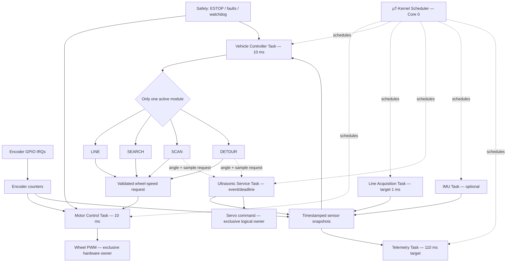
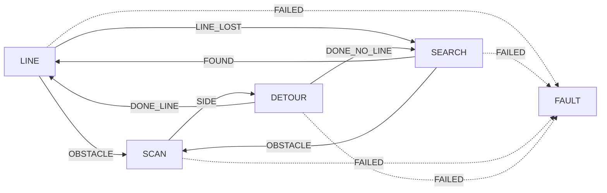

# Robo Pico — RTOS Concurrency & Multicore Architecture Plan

**Project:** INF2004 Embedded Systems / Pico W Robo Car  
**Reference branch:** `yx-detour` (now tag [`archive/yx-detour`](https://github.com/Agoace/INF2004_Embedded_Sys/tree/archive/yx-detour)), inspected at `3ef9e4b` (2026-11-05)  
**Status:** Proposed implementation plan, **not an implemented RTOS design**  
**Scope:** Task scheduling, cooperative navigation handoffs, shared sensor observations, motor ownership, timing, safety, and an optional second-core migration.  
**Non-goal:** Redesign the existing obstacle-detour geometry or claim that the existing firmware already uses μT-Kernel.

## 1. Decision in one paragraph

**Start with μT-Kernel scheduling all application tasks on Core 0.** Keep the proven `LINE → SCAN → DETOUR → SEARCH/LINE` module handoffs inside one **Vehicle Controller task**; keep one **Motor Control task** as the sole motor-PWM owner; move continuous sensor acquisition and telemetry into their own tasks. Sensors publish snapshots; navigation reads those snapshots. An active sensor such as the servo-mounted ultrasonic additionally accepts **asynchronous measurement requests**. Introduce Core 1 only after single-core timing, memory, and safety tests show a real need. A separate Core 1 worker is **not** automatically another μT-Kernel-scheduled task: this depends on whether the actual μT-Kernel port supports SMP.

### Terminology

- **Task:** Independent function with its own stack and scheduling state, managed by the RTOS. It may contain a loop that waits for a period or event.
- **Driver/module:** `LINE`, `SEARCH`, `SCAN`, or `DETOUR` state machine. These are **not** separate RTOS tasks in the proposed design.
- **Scheduler:** Chooses which *ready task* receives CPU time based on priority. It does **not** choose which navigation module owns the car.
- **Vehicle Controller:** Chooses which *navigation module* can issue driving requests. It does **not** schedule unrelated RTOS tasks.
- **Concurrency:** Tasks progress independently via time slicing/preemption on one core.
- **Parallelism:** Two cores execute instructions at the same time; requires an explicit multicore model.

## 2. Target architecture (single-core baseline)



**Interpretation:** The dashed scheduler arrows mean that the kernel makes tasks runnable. They do not represent synchronous function calls. A sensor task can be waiting while navigation and motor tasks continue. The Vehicle Controller only runs one navigation module at a time, even though the acquisition and telemetry **tasks** continue to operate.

**Servo implementation boundary:** Give the ultrasonic service exclusive *logical* authority over requested angles. If the existing `mcp_set_servo()` hardware driver must remain the low-level PWM writer, route ultrasonic-service angle commands through that defined interface. Do not allow arbitrary navigation modules to write servo registers directly. Servo hardware ownership and motor hardware ownership can share a low-level actuator implementation while retaining separate logical request interfaces.

## 3. Proposed task matrix

These are **initial periods and priorities for engineering trials**, not proven WCETs or final compliance figures. μT-Kernel priorities use lower numbers for higher urgency in its normal convention; verify the installed port/configuration before assigning numbers.

| Task / context | Trigger | Initial priority | Responsibilities | Must not do |
|---|---|---:|---|---|
| **Motor Control** | Fixed 10 ms release | 10 | Read encoder snapshot, update PID, enforce setpoint expiry, write wheel PWM, latch motor faults | Wi-Fi, ultrasonic waits, dynamic logging |
| **Line Acquisition** | Fixed 1 ms release (validate feasibility) | 11 | Read IR ADC/digital inputs, update filtered line state and event generation, publish snapshot | Decide detour routing, write motor PWM |
| **Vehicle Controller** | Fixed 10 ms release; urgent safety notification if supported | 13 | Read snapshots, step **one** active navigation module, route outcomes, publish latest motor targets | Direct hardware access, blocking on ultrasonic |
| **Ultrasonic Service** | Request / echo interrupt / settle deadline | 12–20, tune | Own sensor requests; move servo, settle, trigger echo, apply timeouts, publish matching result | Block CPU through an echo delay, modify navigation state |
| **IMU Acquisition** | Optional ~20–40 ms target | 20 | Read accelerometer/magnetometer, publish measurements with validity | Force steering unless deliberately added to policy |
| **Telemetry** | ~110 ms target, lower urgency | 30 | Copy snapshots quickly; queue/send Wi-Fi data and accept validated commands | Hold shared locks during network activity |
| **Encoder IRQ** | GPIO edge | Interrupt | Update encoder count quickly | PID, network, printf |
| **Safety input IRQ** | ESTOP edge | Interrupt | Latch emergency-stop state; arrange immediate safe motor cutoff | Long-running diagnostics |

**Timing discrepancy to resolve:** The live `yx-detour` test firmware drives motor PID every **10 ms**; the older design-review requirement specified **20 ms** for Motion Control. Decide which is binding for the coursework before freezing the RTOS task table. This plan uses **10 ms to preserve current measured behaviour**, subject to requirement approval or amendment.

## 4. How task timing works

A periodic task does not necessarily `execute → sleep(10 ms)`. That would cause its effective period to become **execution time + 10 ms**. Instead it should execute at absolute release times:

```text
Motor releases:    0 ms       10 ms       20 ms       30 ms
Motor executes:    [work]      [work]      [work]      [work]
Vehicle releases:  0 ms       10 ms       20 ms       30 ms
Line releases:     0, 1, 2, 3, ... ms
Telemetry:         0 ms       110 ms      220 ms      ...
```

If the motor update requires 1 ms, it finishes and remains blocked until the next 10 ms release. Other ready tasks execute in between. On a single core, only **one task executes at an instant**, but preemption makes them concurrent.

### Periodic-task pseudocode (API-neutral)

```c
void motor_task(void) {
    deadline_t next = periodic_start(10); // absolute, not relative-to-finish
    for (;;) {
        wait_until(next);
        if (period_was_missed(next)) {
            record_overrun(MOTOR_TASK);
            // Apply defined recovery policy; do not blindly replay old PID steps.
        }
        motor_pid_step();  // bounded, short, no blocking I/O
        next = next_period(next, 10);
    }
}

void vehicle_task(void) {
    deadline_t next = periodic_start(10);
    for (;;) {
        wait_until(next);
        sensor_snapshot_t s = snapshot_read();
        navigation_result_t r = vehicle_sm_step(&vehicle, &s);
        publish_drive_request(r.drive);  // new target with timestamp/epoch
        next = next_period_with_skip_if_late(next, 10);
    }
}
```

This is architecture pseudocode, **not** a promise of exact μT-Kernel function names. Use the installed port's supported timer/wait APIs. A cyclic handler should **wake or signal a task**, not run lengthy task work inside handler context.

### When execution exceeds its period

For example, a Vehicle Controller update with a 10 ms deadline takes 13 ms:

1. The next release arrives before the prior iteration finishes: **deadline miss**.
2. The RTOS cannot manufacture the missing 3 ms. Lower-priority work may be delayed; a higher-priority release might preempt it.
3. Record **start, finish, response time, execution time, jitter and misses**.
4. Do not process a backlog of obsolete navigation decisions. Use the **latest snapshot**, skip stale releases, and log the fault/recovery.
5. Repeated or safety-critical misses trigger a controlled stop. Motor-task deadline misses warrant stricter limits than telemetry misses.

**Do not conflate waiting with CPU execution.** A servo may need 150 ms to settle, but the ultrasonic service should **sleep/await an event** during the delay instead of consuming 150 ms of CPU time.

## 5. Navigation ownership: retain the working module shell

Use the existing pure-logic interfaces and route table as the foundation:

- [`app_program/vehicle/vehicle_sm.c`](https://github.com/Agoace/INF2004_Embedded_Sys/blob/yx-detour/app_program/vehicle/vehicle_sm.c)
- [`app_program/vehicle/vehicle_sm.h`](https://github.com/Agoace/INF2004_Embedded_Sys/blob/yx-detour/app_program/vehicle/vehicle_sm.h)
- [`app_program/subsystem3/line_trace.c`](https://github.com/Agoace/INF2004_Embedded_Sys/blob/yx-detour/app_program/subsystem3/line_trace.c)
- [`app_program/subsystem3/line_search.c`](https://github.com/Agoace/INF2004_Embedded_Sys/blob/yx-detour/app_program/subsystem3/line_search.c)
- [`app_program/subsystem5/servo_scan.c`](https://github.com/Agoace/INF2004_Embedded_Sys/blob/yx-detour/app_program/subsystem5/servo_scan.c)
- [`app_program/subsystem5/detour_run.c`](https://github.com/Agoace/INF2004_Embedded_Sys/blob/yx-detour/app_program/subsystem5/detour_run.c)



Each module exposes `start(context, payload, time)` and `step(context, inputs, time, drive)` (or an equivalent interface). The Vehicle Controller owns routing, safety and the active module ID. Modules **do not** create their own RTOS threads.

**Handoff invariant:** At any instant only one module may publish a valid drive request. The Vehicle Controller invalidates the previous module's command when ownership changes. A handoff may call the next module in the same Vehicle Controller update, as in the current implementation, subject to a bounded number of transitions. Missing routes and transition loops become faults.

**Detour algorithm is unchanged in this migration.** The current `obstacle_detour.c` uses straight segments plus on-the-spot rotations, not the original curved-trajectory Blind Bicycle Algorithm. Treat any BBA replacement as a separately tested navigation-module change.

## 6. Sensor publishing: observations, not decisions

Tasks responsible for sensors **acquire** hardware data. Algorithms **interpret** the latest measurements.

| Data | Producer | Consumer | Special rule |
|---|---|---|---|
| IR values and line state | Line Acquisition | Vehicle Controller, telemetry | Sample even when DETOUR is active |
| Encoder counts | GPIO IRQ, protected copy | Motor PID, navigation, telemetry | Avoid torn/mixed samples |
| Ultrasonic result | Ultrasonic Service | SCAN / DETOUR / LINE, telemetry | Result includes request ID, servo angle and time |
| IMU | IMU Service | Vehicle Controller (optional), telemetry | Validity and age exposed |
| Motor actual speed, duty and faults | Motor Control | Vehicle Controller, telemetry | Controller publishes status; telemetry is read-only |

### Proposed observation contract

```c
typedef struct {
    uint32_t timestamp_ms;
    uint32_t sequence;
    uint16_t line_raw[3];
    bool line_seen;
    int8_t line_position;
    int32_t encoder_counts[2];
    int16_t actual_speed_mm_s[2];
    uint16_t obstacle_mm;
    uint32_t obstacle_request_id;
    int8_t obstacle_angle_deg;
    bool obstacle_valid;
    uint32_t obstacle_timestamp_ms;
    uint32_t fault_bits;
} robot_snapshot_t;
```

The precise fields are a proposed schema; integrate existing `line_position`, `mcp_status`, and ultrasonic result types rather than duplicating calculations.

**Synchronization:** Hold a suitable RTOS mutex/short critical section only long enough to copy the snapshot; release it before steering calculations or telemetry/network sends. Use per-field timestamps when sensors have different ages. On Core 1, ordinary interrupt masking on Core 0 alone is **not** a cross-core lock: use primitives proven safe on both cores. Never treat `volatile` alone as complete synchronization.

## 7. Active sensors: asynchronous request interface

Unlike fixed IR sensors, the servo-mounted ultrasonic needs a **command**: target angle and when to measure.

```mermaid
sequenceDiagram
    participant VC as Vehicle Controller / DETOUR
    participant US as Ultrasonic Service
    participant IRQ as Echo ISR
    participant MC as Motor Control
    VC->>US: request(id=42, angle=+30°, max_age/deadline)
    VC->>MC: wheel target = STOP or safe crawl
    US->>US: command servo + wait settle deadline
    Note over VC,US: Other tasks continue while the servo settles
    US->>IRQ: trigger ultrasonic ping
    IRQ-->>US: echo pulse timestamp / timeout
    US->>US: publish result(id=42, angle=+30°, distance, timestamp)
    US-->>VC: signal result ready
    VC->>VC: verify id, age, validity; decide next step
```

### Proposed request/result API (illustrative)

```c
typedef struct {
    uint32_t request_id;
    uint32_t generation;       // Increment on navigation ownership change
    int8_t angle_deg;          // Physically permitted angle, e.g. -30..+30
    uint32_t deadline_ms;
} sonar_request_t;

typedef struct {
    uint32_t request_id;
    uint32_t generation;
    int8_t measured_angle_deg;
    uint32_t timestamp_ms;
    uint16_t distance_mm;
    enum { SONAR_OK, SONAR_NO_ECHO, SONAR_TIMEOUT, SONAR_CANCELLED } status;
} sonar_result_t;
```

- **One outstanding measurement per sensor** is the simplest initial design. Reject or explicitly replace conflicting requests; don't silently overwrite.
- The sensor service is the sole owner of measurement timing: servo settling, minimum echo interval, trigger, echo timeout.
- A module waits **logically** through its own state machine; it never calls a blocking hardware wait inside `step()`.
- When SCAN hands off to DETOUR, increment a **generation/ownership token**. Late SCAN results must not be consumed by DETOUR.
- On STOP/FAULT, cancel requests and leave the servo in the defined safe position if possible.
- The physical servo travel limit must be enforced (existing code uses **±30°**; verify the actual mounted range, which may be smaller).

### Suggested RTOS mechanisms

- **Message buffer / mailbox:** Send a bounded request or control event (`tk_cre_mbf`, `tk_cre_mbx` family where supported).
- **Event flag / semaphore:** Wake ultrasonic service or notify completion (`tk_cre_flg`, `tk_set_flg`, `tk_wai_flg`, etc.).
- **Mutex:** Protect a short shared snapshot copy (`tk_cre_mtx`); prefer bounded waiting or single-writer patterns where practical.
- **Cyclic handler / alarm:** Release periodic tasks or timeouts; handler should do minimal work.

Use the actual port documentation to choose APIs and whether tasks can be awakened from the specific interrupt context; do not blindly call a generic kernel API in an ISR.

## 8. Drive requests and safety

Only the **Vehicle Controller** publishes navigation requests; only **Motor Control** converts requested speeds into wheel PWM.

```c
typedef struct {
    int16_t left_mm_s;
    int16_t right_mm_s;
    uint32_t issued_ms;
    uint32_t valid_until_ms;
    uint32_t generation;
    bool emergency_stop;
} drive_request_t;
```

**Safety rules:**

1. Motor PWM is owned by one task/hardware driver. No navigation module writes PWM directly.
2. Requests include a timestamp or expiry. If the Vehicle Controller stops publishing, **motor targets become zero**, then a fault is latched per policy.
3. A newer driver generation invalidates commands issued before the handoff.
4. ESTOP has priority over all module outcomes and motor requests. Hardware-level immediate stop must not wait for the next 10 ms navigation update.
5. Motor stall, encoder fault, stale critical sensor data and repeated missed motor deadlines can trigger a controlled stop.
6. The watchdog must depend on **health/progress of critical control tasks**, not merely an always-running tick interrupt. Otherwise a stuck Vehicle Controller could remain hidden while the timer keeps feeding the watchdog.
7. Wi-Fi commands require validation and cannot bypass local ESTOP/fault latches.

**Important transition detail:** A queued `STOP` request must not wait behind older drive commands. Use a latest-value setpoint slot with a separate high-priority fault/stop path, or otherwise demonstrate bounded emergency-stop latency.

## 9. Multicore plan: optional second phase

The Pico W's RP2040 has **two Cortex-M0+ cores and 264 KB SRAM**. Hardware parallelism is available; **automatic SMP scheduling is not guaranteed by the installed μT-Kernel port**. Verify the actual kernel build, platform port, interrupts and context-switch implementation before any multicore claim.

### Mode A — preferred initial architecture: Core 0 only

```text
CORE 0: μT-Kernel
  Motor Control (high priority)
  Line Acquisition
  Vehicle Controller
  Ultrasonic Service
  IMU (optional)
  Telemetry (low priority)
CORE 1: unused
```

**Why first:** One scheduler, fewer race conditions, easier timing measurements, simpler Wi-Fi integration, closest migration path from the existing single-core test firmware.

### Mode B — optional AMP: kernel on Core 0, worker on Core 1

```text
CORE 0                                   CORE 1
μT-Kernel task scheduler                 Separate worker loop / execution environment
  Motor, line, vehicle                      Selected noncritical workload
  Time-critical sensor service             e.g. telemetry packaging / computation
  Safety                                     (NOT direct motor hardware writes)
            \                              /
             Shared snapshots + bounded queue
               cross-core synchronization
```

- Treat Core 1 as **separately managed execution**, not as a task automatically preempted by μT-Kernel on Core 0.
- Do not move the Wi-Fi driver to Core 1 until ownership and **Pico W CYW43 driver/thread-safety support** are verified for the selected SDK integration.
- Move **one** noncritical, easily isolated workload first. Measure whether it actually reduces Core 0 worst-case latency.
- Establish a single producer/consumer protocol; avoid lock-heavy global objects and blocking cross-core FIFO operations in critical paths.
- Do not mix RTOS and SDK synchronization primitives casually: prove that the primitive works across the selected task and core contexts.

### Mode C — SMP (deferred)

One scheduler can place tasks across both cores **only if a supported SMP-enabled RTOS port is available and validated**. Do not assume μT-Kernel's generic task scheduler provides this. If the coursework mandates μT-Kernel, changing to a different SMP RTOS is a separate requirements decision, not an implicit optimization.

### Decision gate

Use Core 1 only if measured single-core worst-case latency, deadline misses, or Wi-Fi interference remain unacceptable **after** removing blocking operations and correcting task priorities. Document the symptom, expected benefit, synchronization cost and benchmark evidence.

## 10. Migration plan — preserve proven behaviour

### Phase 0 — establish baseline

- [ ] Freeze a known-good `yx-detour` commit and retain its host tests and robot logs; do not overwrite evidence.
- [ ] Record known timings: 10 ms motor PID, 1 ms IR acquisition target, 10 ms Vehicle Controller, ultrasonic minimum interval and Wi-Fi cost.
- [ ] Re-run the current integrated route `LINE → SCAN → DETOUR → SEARCH/LINE` before any RTOS modifications.
- [ ] Resolve the 10 ms live PID vs 20 ms design-review requirement discrepancy.
- [ ] Confirm physical servo range and IR configuration (two- versus three-sensor line mode).

**Exit:** Known-good firmware and repeatable performance/safety baseline.

### Phase 1 — isolate service interfaces in the current code

- [ ] Keep pure logic in `vehicle_sm`, `line_trace`, `line_search`, `servo_scan`, `detour_run`, and `obstacle_detour`.
- [ ] Add sensor snapshot types and accessors; avoid sensor hardware calls from navigation functions.
- [ ] Add bounded asynchronous sonar request/result contract with request ID and generation.
- [ ] Add drive-request expiry/generation semantics and explicit fault precedence.
- [ ] Host-test stale results, fast handoffs, no-result timeouts and STOP override.

**Exit:** Pure modules work against fake acquisition/actuation services on the host.

### Phase 2 — bring up μT-Kernel on one core

- [ ] Confirm the Pico W kernel port, SDK/IRQ interoperability, timebase and Wi-Fi integration are supported.
- [ ] Create Motor Control, Line Acquisition, Vehicle Controller, Ultrasonic Service and Telemetry tasks.
- [ ] Configure periodic wakeups and event waits; eliminate the old app-level heartbeat flags as *the* foreground scheduling mechanism.
- [ ] Keep encoder IRQ handlers short and protect shared counter snapshots.
- [ ] Keep peripheral ownership single-writer and no blocking I/O in high-priority control tasks.
- [ ] Verify stack high-water marks and total SRAM (264 KB shared across both cores).

**Exit:** Stable line-following and safety tests with only one core and RTOS task scheduling.

### Phase 3 — restore integrated navigation

- [ ] Register the four navigation modules under the single Vehicle Controller task.
- [ ] Restore LINE → SCAN → DETOUR → LINE/SEARCH with untouched decision logic wherever feasible.
- [ ] Check request IDs, sensor age, yaw/encoder status and generation changes at every handoff.
- [ ] Validate telemetry under full-speed control without affecting motor deadlines.
- [ ] Repeat physical R3/R4-style obstacle tests; record successful return to sustained line following, not merely `DONE`.

**Exit:** Measured functional equivalence or better, including line reacquisition and fault stops.

### Phase 4 — measure and harden

- [ ] Measure per-task minimum/average/maximum execution time, response time, release jitter, deadline misses and queue depth.
- [ ] Test sensor echo loss, unplugged sensors, motor stall, delayed Wi-Fi, queue saturation and command starvation.
- [ ] Measure worst-case motor STOP/ESTOP latency (from event to PWM-off), under load.
- [ ] Ensure watchdog is fed only when critical tasks report current progress.
- [ ] Determine whether observed obstacle clearance at **400 mm straight** is robust across different box orientations/surfaces.

**Exit:** Evidence that critical task deadlines and fail-safe conditions are satisfied.

### Phase 5 — evaluate Core 1 (only if justified)

- [ ] Decide between verified SMP support or a controlled AMP worker; document rationale.
- [ ] Port one noncritical service, enforce single-writer shared-state rules and add cross-core tests.
- [ ] Repeat latency, CPU-load, memory, power and safety measurements.
- [ ] Keep the single-core build as a reliable fallback.

**Exit:** Adopt dual core only if benefits are measurable and all safety regressions pass.

## 11. Test matrix and acceptance evidence

| Test | Expected result / measurement |
|---|---|
| Periodic release | Motor and Vehicle Controller releases remain on 10 ms cadence within a **measured** bounded jitter; record actual threshold from requirements/experiments |
| Foreground Wi-Fi load | No motor deadline miss or unexpected PWM change during telemetry bursts |
| Long servo settle | Vehicle/Motor tasks continue; ultrasonic service sleeps rather than spinning |
| Echo timeout | Deterministic timeout/status, no indefinite wait, navigation safe decision |
| Rapid SCAN → DETOUR transition | Old-generation sonar result rejected |
| Driver handoff | Only new active driver publishes commands; no stale setpoint persists |
| Vehicle task halted | Motor request expiry causes safe zero target / latched fault |
| ESTOP while moving | PWM reaches zero within the project safety bound; verify on hardware |
| Obstacle detour | Successful bypass, stable reacquisition, no collision or stall |
| Repeated overload | Deadline miss counter increases and configured safe recovery executes |
| Optional Core 1 active | No data races, no unexpected stalls; performance improvement quantified |

**Note:** The old design review calls for stopping PWM within **20 ms after the safety event reaches the controller**. Hardware ESTOP should ideally act sooner; verify the full end-to-end bound rather than relying only on timer arithmetic. The earlier obstacle-bypass duration target (<3 s) conflicts with real detour observations around 20+ s: treat that as a tracked requirement gap, not as an already satisfied condition.

## 12. Risks, open decisions, and constraints

1. **μT-Kernel portability:** Validate a working Pico W port (tick, interrupt priorities, thread contexts, SDK, CYW43), not just the generic kernel specification.
2. **Timer scheduling:** Use absolute periodic release/event waits; measure actual tick granularity and jitter. A 1 ms line task is feasible only if total worst-case work allows it.
3. **Priority inversion:** Snapshot locks must be short; use priority inheritance or appropriate patterns where supported.
4. **Memory:** Pico W RP2040 has 264 KB shared SRAM. Plan task stacks, kernel objects, Wi-Fi buffers, logs and trace storage explicitly.
5. **Cross-core safety:** `volatile` does not solve cache/memory-ordering/compound-operation hazards; verify synchronization primitives in the chosen runtime.
6. **Servo and sonar physics:** Valid angle, settle time, min ping interval and echo validity are hardware constraints independent of scheduler speed.
7. **Navigation limitations:** R4 completed two detours, but false-line reacquisition and small modeled clearances remain open. RTOS migration will not fix geometric/sensor limitations.
8. **Watchdog:** A timer ISR feeding the watchdog unconditionally is insufficient evidence that application control tasks are healthy.

## 13. Definition of done

The architecture is ready for integration when:

- [ ] One μT-Kernel scheduler controls all Core 0 RTOS tasks.
- [ ] Navigation module handoffs remain pure, bounded and exclusive.
- [ ] Motor PWM has one writer; safety overrides all normal commands.
- [ ] Sensor producers publish timestamped data without blocking navigation.
- [ ] Ultrasonic requests/results are asynchronous and cannot be confused across handoffs.
- [ ] Periods/deadlines are measured on hardware and overruns have documented handling.
- [ ] Telemetry does not delay safety-critical control.
- [ ] Single-core system completes representative obstacle and line runs, including stable post-detour line reacquisition.
- [ ] Second-core use remains optional unless validated measurements justify it.

## 14. Reference material

**Project source:**
- [Branch `yx-detour`](https://github.com/Agoace/INF2004_Embedded_Sys/tree/yx-detour)
- [Vehicle State Machine implementation](https://github.com/Agoace/INF2004_Embedded_Sys/blob/yx-detour/app_program/vehicle/vehicle_sm.c)
- [Current test firmware, `vc_line_test.c`](https://github.com/Agoace/INF2004_Embedded_Sys/blob/yx-detour/src/vc_line_test.c)
- [Current integration test report, `VC_DETOUR_RUN.md`](https://github.com/Agoace/INF2004_Embedded_Sys/blob/yx-detour/docs/VC_DETOUR_RUN.md)

**Official platform/kernel documentation:**
- [Raspberry Pi Pico / Pico W hardware overview](https://www.raspberrypi.com/documentation/microcontrollers/pico-series.html)
- [Pico SDK multicore and synchronization API](https://www.raspberrypi.com/documentation/pico-sdk/high_level.html)
- [Pico SDK hardware spin locks](https://www.raspberrypi.com/documentation/pico-sdk/hardware.html)
- [μT-Kernel 3.0 task scheduling rules](https://tron-forum.github.io/mtk3_spec_en/task_states_and_scheduling_rules.html)
- [μT-Kernel 3.0 time management and cyclic handlers](https://tron-forum.github.io/mtk3_spec_en/time_management_functions.html)
- [μT-Kernel OS API index](https://tron-forum.github.io/mtk3_spec_en/index_of_utk_os_api.html)

---

**Preferred implementation order:** Single-core RTOS correctness → separation of sensor acquisition and navigation → deterministic timing/safety evidence → optional multicore profiling and migration. **Do not introduce the second core solely because it exists.**
